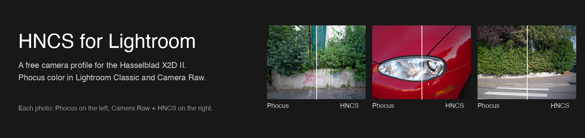
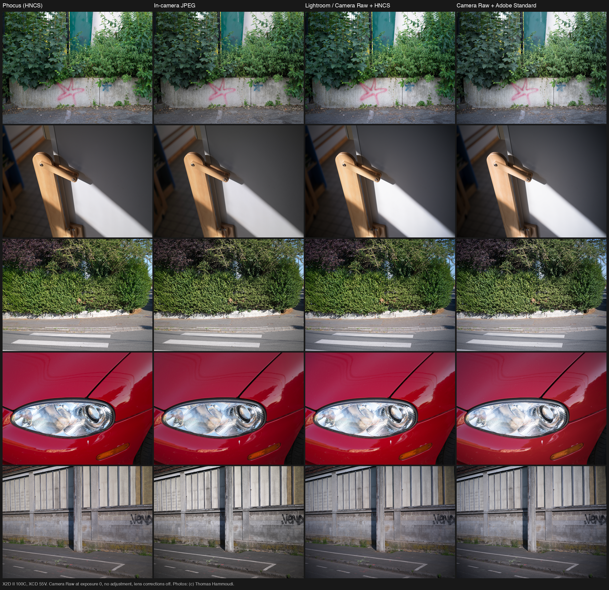
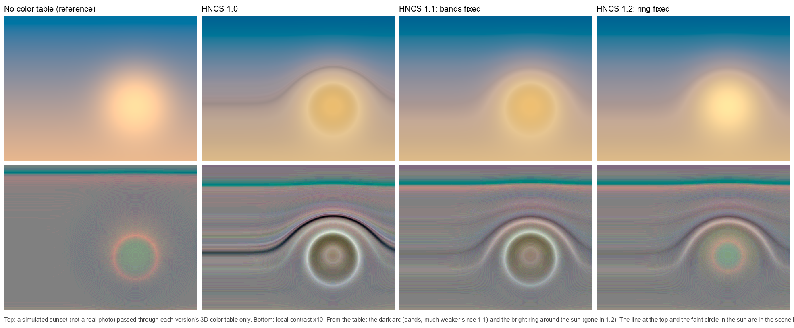

[English](README.md) | **Français**

# HNCS : profil couleur Hasselblad X2D II pour Lightroom Classic

Un profil caméra Adobe (`.dcp`) gratuit pour Lightroom Classic et Camera Raw qui reproduit la couleur HNCS de Hasselblad du X2D II 100C : un 3FR prend le rendu de Phocus sans ouvrir Phocus. C'est un profil caméra, pas un preset, et il fonctionne sur Mac et Windows. Depuis la version 2.0, le dépôt contient aussi un module facultatif pour Lightroom Classic qui règle Exposition, Ombres et Hautes lumières photo par photo (macOS seulement pour l'instant, voir [Module Lightroom](#module-lightroom-facultatif)).

*Cinq photos tenues à part de l'ajustement. Camera Raw à l'exposition 0, sans aucun réglage, corrections d'objectif désactivées ; la luminosité de chaque photo est celle que le boîtier écrit dans le 3FR. Phocus et le JPEG du boîtier servent de références. Les légendes des images sont en anglais.*

## Télécharger

### ➜ [**HNCS-Hasselblad-X2D-II.dcp** (dernière release)](https://github.com/ThomasHMD/hncs-lightroom-profile/releases/latest/download/HNCS-Hasselblad-X2D-II.dcp)

28 Ko, pour le X2D II 100C. **X2D 100C de première génération (2022) ?** Prenez plutôt [**HNCS-Hasselblad-X2D-100C.dcp**](https://github.com/ThomasHMD/hncs-lightroom-profile/releases/latest/download/HNCS-Hasselblad-X2D-100C.dcp) : même profil, associé au nom d'appareil du X2D (voir [L'utiliser](#lutiliser)). Toutes les versions sont dans les [Releases](https://github.com/ThomasHMD/hncs-lightroom-profile/releases). Les outils qui ont ajusté les versions 1.x sont dans ce dépôt, sous licence MIT (voir [Licence](#licence)).

Facultatif, pour Lightroom Classic sur macOS : [**HNCS-Lightroom-module.zip**](https://github.com/ThomasHMD/hncs-lightroom-profile/releases/latest/download/HNCS-Lightroom-module.zip) (10 Ko), un module qui règle Exposition, Ombres et Hautes lumières photo par photo (voir [Module Lightroom](#module-lightroom-facultatif)).

## Nouveautés

### 2.1 : correction d'exposition par objectif (module Lightroom 1.1)

Le profil ne change pas : c'est toujours la 2.0, même nom de fichier. Seul le module Lightroom passe en 1.1.0.

**Pourquoi.** Camera Raw applique le profil d'objectif d'Adobe (distorsion et vignettage) par-dessus le profil caméra, et ce profil d'objectif éclaircit les bords du cadre plus que Phocus ne le fait. Sur les photos où le boîtier n'a pris aucune décision de luminosité (le module les laissait tranquilles), toute l'image sort un peu trop claire. Le module 1.1 règle maintenant **l'Exposition seulement** pour ces photos (pas de décisions du boîtier dans le fichier, ISO sous 6400), selon l'objectif. Ombres et Hautes lumières ne sont pas touchées. L'objectif est lu dans le fichier ; un objectif inconnu (ou un HC) ne change rien. Le module choisit l'une de deux colonnes d'après le réglage *Activer les corrections de profil* de la photo, et s'il ne peut pas le savoir il prend la colonne « coupées ».

| Objectif | Corrections d'objectif actives | Corrections d'objectif coupées |
|---|---|---|
| XCD 55V | −0,15 | −0,05 |
| XCD 38V | −0,20 | −0,05 |
| XCD 35-100E | −0,05 | −0,03 |

Ces trois valeurs sont mesurées sur mes propres photos. Le module porte aussi de petites valeurs pour cinq autres objectifs (XCD 120, 135, 20-35E, 25V, 90V) que je n'ai pas mesurés moi-même : elles viennent d'un échange de mesures avec un autre photographe de X2D II.

**Ce que ça apporte**, dans Camera Raw contre Phocus, sur les 41 photos tenues hors de l'ajustement, corrections d'objectif **actives** (la façon de travailler de la plupart) : le module 1.1 est plus proche de Phocus que le module 1.0 sur 24 photos, à égalité sur 14 et plus éloigné sur 3 (un écart sous 0,05 compte pour « égal »), et le ΔE2000 médian passe de 2,01 à 1,49. Avec les corrections d'objectif **coupées**, aucun gain n'est prouvé (1,41 à 1,40 ; plus proche sur 17, égal sur 17, plus éloigné sur 7) : la colonne « coupées » n'est qu'une valeur prudente.

**Limites.** Les références sont des exports Phocus 4.1.2. Les valeurs ont été mesurées sur le tiers central du cadre, là où le profil d'objectif pèse le moins : c'est un compromis entre le centre et les bords. L'ouverture joue (le 55V demande environ −0,10 diaphragmé), et une valeur par objectif ne peut pas la suivre. **Le module écrase maintenant le curseur Exposition** de ces photos (Édition ▸ Annuler le remet).

Essayé dans Lightroom Classic sur 8 photos (55V, 38V, 35-100E, ISO 6400 et les trois cas avec décisions du boîtier), corrections d'objectif coupées puis actives : les valeurs sont celles du tableau, et Annuler remet tout.

### 2.0 : des couleurs plus régulières, bien plus robuste quand on pousse les réglages

La version 2.0 est un profil amélioré. La fidélité à Phocus reste la même que celle de la 1.2 (ΔE2000 médian 1,03 contre 1,04, sur 34 photos tenues hors de l'ajustement de la 1.2). Ce qui change, c'est la table de couleurs, bien plus régulière :

- **Elle tient beaucoup mieux sous les réglages locaux.** Avec un masque sur un ciel et de forts changements de balance des blancs, de teinte ou de saturation, la 1.2 pouvait casser les dégradés lisses en plaques ou en bandes (un utilisateur de X2D l'a signalé). J'ai compté les pixels d'un ciel où un dégradé casse après un réglage, sur 13 ciels chauds et bleus et 9 réglages chacun (109 cas) : médiane de 16 pour mille pour la 2.0, 137 pour la 1.2, et 16 pour le profil par défaut de Camera Raw. Un cas reste un peu moins bon que la 1.2 : ajouter de la saturation (24 contre 15 pour mille).
- **La table de couleurs est plus lisse** : le plus grand saut entre deux entrées voisines est de 3,4 contre 14,2 dans la 1.2.
- **Pas meilleure partout.** Contre le JPEG du boîtier, elle n'est pas plus proche que la 1.2 (2,31 contre 2,33, 8 photos). Photo par photo contre Phocus, elle est plus proche sur 17 photos sur 34, nettement plus proche (de plus de 0,3) sur 5 et nettement plus éloignée sur 9. Telle quelle, sans correction d'exposition, elle est un peu plus éloignée de Phocus (1,35 contre 1,26). Détails dans [Précision](#précision).
- **Même nom, couleurs un peu différentes.** Le profil s'appelle toujours **HNCS** : les photos qui l'utilisent déjà passent d'elles-mêmes à la 2.0. Si vous préférez l'ancien rendu, la 1.2.1 reste téléchargeable dans les [Releases](https://github.com/ThomasHMD/hncs-lightroom-profile/releases).
- **Nouveau : un module Lightroom facultatif**, voir [Module Lightroom](#module-lightroom-facultatif).
- La variante `HNCS-Hasselblad-X2D-100C.dcp` est refaite à partir de la 2.0 de la même façon qu'avant. Elle n'a pas été mesurée sur des fichiers de X2D.

Les figures et le premier tableau plus bas ont été faits avec la 1.0. Les scripts de `tools/` sont ceux des versions 1.x.

### 1.2 : plus d'anneau autour du soleil

Dans les couchers de soleil à contre-jour, la version 1.1 pouvait dessiner un anneau orange plus sombre autour du soleil. La cause était le haut de la table de couleurs 3D : pour les tons jaune-orangé très clairs, elle divisait la luminosité par deux, si bien que le ciel s'assombrissait en approchant du soleil, puis passait d'un coup au blanc. Dans la 1.2, la luminosité monte toujours avec la lumière, partout dans la table. Je l'ai vérifiée sur six couchers de soleil à contre-jour envoyés par un utilisateur de X2D. Rien d'autre ne change : sur les mêmes 16 photos de test que pour la 1.1, la fidélité à Phocus est identique (ΔE2000 médian 1,21 tel quel), et la correction des bandes de la 1.1 est gardée. Le contrôle automatique refuse désormais aussi un profil dont la luminosité redescend quelque part.

### 1.1 : correction des bandes dans les ciels

La version 1.0 pouvait montrer de légères bandes roses et vertes dans les dégradés lisses et pâles, typiquement un ciel de coucher de soleil qui passe du bleu au jaune près de l'horizon (merci à l'utilisateur de X2D qui l'a signalé avec un fichier de test). La cause était la table de couleurs 3D du profil : pour les couleurs presque grises, sa correction changeait brutalement d'une teinte à la voisine. Un ciel pâle qui passe du bleu au jaune traverse le gris : il balaie toutes les teintes en quelques pixels, et chacune recevait une correction un peu différente.

La 1.1 lisse cette partie de la table et réduit de moitié la correction des couleurs presque grises. Le reste (courbe de tons, matrices, couleurs saturées) ne change pas. Sur la photo signalée, les bandes ont disparu et le ciel est à peu près aussi lisse qu'avec Adobe Standard. La fidélité à Phocus ne s'est pas dégradée : sur 16 des 41 photos de test, rendues à nouveau dans Camera Raw, le ΔE2000 médian vaut 1,03 pour la 1.1 et 1,05 pour la 1.0 avec l'exposition réglée photo par photo, et 1,21 contre 1,30 tel quel. Un contrôle permanent fait maintenant passer des dégradés synthétiques par le gris, dans `tools/adoucir_look.py --self-test`.

Si vous avez installé une version précédente, remplacez le fichier par le nouveau (même nom, même endroit) et relancez Lightroom. Le profil garde son nom, **HNCS** : les photos qui l'utilisent déjà passent d'elles-mêmes à la nouvelle version.

## Installer

Le profil va dans le dossier **utilisateur** de Camera Raw. Pas dans le dossier de l'application, pas dans le dossier système.

1. Quittez Lightroom Classic.
2. Copiez le `.dcp` de votre boîtier (`HNCS-Hasselblad-X2D-II.dcp`, ou `HNCS-Hasselblad-X2D-100C.dcp` pour le X2D de première génération) dans :
   - **macOS** : `~/Library/Application Support/Adobe/CameraRaw/CameraProfiles/`
     (dans le Finder : Aller ▸ Aller au dossier…, puis collez le chemin ; le dossier `Library` est masqué)
   - **Windows** : `%APPDATA%\Adobe\CameraRaw\CameraProfiles\`
     (collez-le dans la barre d'adresse de l'Explorateur ; c'est `C:\Users\<votre-nom>\AppData\Roaming\Adobe\CameraRaw\CameraProfiles\`)
3. Relancez Lightroom Classic.

Pourquoi ce dossier : les dossiers système (`/Library/Application Support/Adobe/CameraRaw/CameraProfiles/` sur macOS, `C:\ProgramData\Adobe\CameraRaw\CameraProfiles\` sur Windows) contiennent les profils d'Adobe et sont gérés par son installateur et ses mises à jour, qui peuvent les réécrire. Le dossier utilisateur est le vôtre : Lightroom le lit, et une mise à jour n'y touche pas. Après une grosse mise à jour de Lightroom ou de Camera Raw, vérifiez que le profil est toujours listé. Sinon, le fichier est toujours dans le dossier : relancez d'abord Lightroom, et certains utilisateurs disent que réinitialiser ses préférences ramène les profils tiers.

Copier le fichier à la main, comme ci-dessus, est la méthode que j'ai testée.

## L'utiliser

1. Ouvrez un 3FR du X2D II dans le module Développement.
2. Panneau Réglages de base ▸ **Profil** ▸ Parcourir (l'icône à quatre carrés). Le profil s'appelle **HNCS** et se trouve dans le groupe **Profils**, sous Camera Matching (pas dans Adobe Raw). Le curseur **Niveau** en haut de l'explorateur permet de l'atténuer. Cliquez sur l'étoile pour le mettre en favori : il apparaît alors dans la liste déroulante Profil.
3. Le profil n'apparaît que pour les fichiers du boîtier auquel il est associé. `HNCS-Hasselblad-X2D-II.dcp` l'est au nom d'appareil d'Adobe `Hasselblad 100-22-Coated6` (X2D II 100C) : je ne l'ai testé que sur ce boîtier. `HNCS-Hasselblad-X2D-100C.dcp` est le même profil associé à `Hasselblad 100-20-Coated6` (X2D 100C de première génération, même capteur). Il reprend l'ajustement du X2D II et **n'a pas été mesuré sur des fichiers de X2D** : un utilisateur de X2D signale qu'il se charge et fonctionne. Si vous avez les deux boîtiers, les deux fichiers peuvent cohabiter dans le dossier : chacun n'apparaît que pour son boîtier.

### En faire le défaut du X2D II

1. Sur une photo du X2D II, choisissez HNCS comme ci-dessus.
2. Dans le panneau Paramètres prédéfinis, clic droit ou menu **+** ▸ **Créer un paramètre prédéfini…**. Nommez-le `HNCS`, cliquez sur **Ne rien sélectionner**, cochez seulement **Traitement et profil**, créez.
3. Lightroom Classic ▸ Préférences (Édition ▸ Préférences sous Windows) ▸ onglet **Paramètres prédéfinis** ▸ **Paramètres par défaut Raw**. Cochez **Remplacer le paramètre global pour des appareils photo spécifiques**, choisissez **Hasselblad X2D II 100C** dans la liste **Appareil photo :**, puis dans **Par défaut :** choisissez **Paramètres prédéfinis** et votre paramètre `HNCS`.

La liste des appareils vient des photos raw déjà présentes dans votre catalogue : importez d'abord au moins une photo du X2D II. Ne choisissez pas **Paramètres de l'appareil photo** pour cela : il ne reprend que les styles appliqués dans le boîtier et ne connaît pas ce profil. Le défaut s'applique aux photos importées ensuite ; pour celles déjà dans le catalogue, appliquez-leur le paramètre prédéfini. Les noms de menus sont ceux de l'application Lightroom Classic elle-même ; documentation d'Adobe (en anglais) : [Set up default settings for raw images](https://helpx.adobe.com/lightroom-classic/desktop/help/raw-defaults.html).

## Luminosité

HNCS règle aussi la luminosité de chaque photo automatiquement. Le boîtier écrit cette décision dans le 3FR (la balise `BaselineExposure` : 0, +1 ou +2 IL selon la prise de vue), et Lightroom et Camera Raw l'appliquent déjà d'eux-mêmes. La luminosité suit donc celle de Phocus, à peu près. Sur les 41 images que j'ai gardées de côté pour le test, l'écart restant avec Phocus est faible, en général dans ±0,2 IL (médiane −0,03 IL, extrêmes −0,57 et +0,20 IL). Les photos dont la balise vaut +1 ou +2 IL sortent environ 0,2 IL plus claires que Phocus. Une petite retouche du curseur Exposition est donc possible, et parfois utile.

## Module Lightroom (facultatif)

**Pourquoi un module en plus du profil ?** Le boîtier décide une luminosité pour chaque photo. Quand un JPEG ou un HEIF HDR est enregistré avec le RAW (en général à ISO 100 ou 200), il remonte souvent l'image en numérique de 1 ou 2 IL, et il décide aussi de combien relever les ombres et retenir les hautes lumières. Ces décisions sont écrites dans le 3FR, et seulement dans ce cas : un fichier en RAW seul n'en porte aucune. Un profil est la même recette pour toutes les photos : il ne peut pas varier d'une photo à l'autre. Le module lit les décisions du boîtier dans chaque fichier et règle Exposition, Ombres et Hautes lumières photo par photo, avec le profil, en une seule opération qu'on peut annuler.

**Ce qu'il apporte**, mesuré dans Camera Raw contre Phocus (ΔE2000 médian, photos tenues hors du réglage, profil 2.0) :

| Photos | Sans le module | Avec le module |
|---|---|---|
| Décisions du boîtier présentes, remontée de 1 ou 2 IL (8 photos) | 3,86 | **2,20** |
| Sans décisions du boîtier, ISO 6400 et plus (14 photos) | 3,11 | **2,22** |
| Toutes les autres (sans décisions du boîtier, sous ISO 6400) | 1,18 | module 1.0 : laissées telles quelles ; module 1.1 : Exposition réglée selon l'objectif, voir [Nouveautés](#nouveautés) |

Les échantillons sont petits : ces chiffres sont une indication. Ils ont été mesurés dans Camera Raw (Photoshop), pas dans Lightroom lui-même. Le seuil d'ISO 6400 a été fixé sur ces mêmes 14 photos (à ISO 3200, la correction rendait 5 photos sur 6 moins bonnes) : cette ligne n'est donc pas un chiffre hors échantillon, et aucune photo entre ISO 3200 et 6400 n'était disponible.

**Installation** (macOS, Lightroom Classic) :

1. Installez `exiftool` (`brew install exiftool`, ou l'installateur de exiftool.org) et le profil HNCS (voir [Installer](#installer)).
2. Téléchargez [`HNCS-Lightroom-module.zip`](https://github.com/ThomasHMD/hncs-lightroom-profile/releases/latest/download/HNCS-Lightroom-module.zip), décompressez-le et placez le dossier `reglages-x2d.lrplugin` à un endroit où il restera (le même dossier est dans [`plugin/`](plugin/)).
3. Dans Lightroom Classic : **Fichier ▸ Gestionnaire de modules externes… ▸ Ajouter**, choisissez le dossier `reglages-x2d.lrplugin`, puis **Terminé**. Le module affiche une pastille verte, « Installé et en cours d'exécution ».
4. Si `exiftool` n'est pas dans `/opt/homebrew/bin`, `/usr/local/bin` ou `/usr/bin` : **Bibliothèque ▸ Modules externes ▸ Réglages du module (chemin d'exiftool)** et saisissez son chemin.

**L'utiliser.** Sélectionnez des photos dans la Bibliothèque, puis **Bibliothèque ▸ Modules externes ▸ Appliquer profil et réglages X2D II** (le même menu existe dans Fichier ▸ Modules externes). Seuls les 3FR du X2D II sont traités ; les autres photos sont ignorées et comptées. Sans sélection, il ne se passe rien. Une fenêtre résume ce qui a été fait. Le module écrit dans le catalogue Lightroom seulement, jamais dans vos fichiers, et ne touche pas aux autres réglages (balance des blancs, netteté, recadrage). Les menus et les messages sont en français pour l'instant.

| Photo | Profil | Exposition | Ombres | Hautes lumières |
|---|---|---|---|---|
| Sans décisions du boîtier dans le fichier, ISO inférieur à 6400 | HNCS | selon l'objectif (tableau dans [Nouveautés](#nouveautés) ; inchangée pour un objectif inconnu) | inchangées | inchangées |
| Sans décisions du boîtier, ISO 6400 ou plus | HNCS | −0,15 | 0 | 0 |
| Décisions du boîtier présentes, remontée d'environ 0 IL | HNCS | +0,05 | +10 | −5 |
| Décisions du boîtier présentes, remontée d'environ 1 IL | HNCS | −0,20 | +5 | −20 |
| Décisions du boîtier présentes, remontée d'environ 2 IL | HNCS | −0,10 | 0 | −50 |

**Annuler** : **Édition ▸ Annuler « Réglages X2D II (HNCS) »** remet le profil et les trois curseurs comme avant, pour toutes les photos d'un coup.

**État du module.** J'ai essayé la version 1.1 dans Lightroom Classic sous macOS, sur 8 photos couvrant les cas ci-dessus (corrections d'objectif actives et coupées), en vérifiant les curseurs contre la règle, photo par photo, et l'annulation. Pas encore essayées dans Lightroom : les sélections mixtes avec des fichiers qui ne sont pas des 3FR (la règle elle-même a été vérifiée hors de Lightroom). **Windows : non testé**, le module s'arrête avec un message plutôt que de deviner. Les règles des photos avec décisions du boîtier ont été fixées sur peu de photos (11 tenues à part), et un vieux catalogue à ancienne version de traitement peut ignorer certains curseurs.

## Précision

Les écarts sont mesurés contre un export Phocus (réglages par défaut, SDR) du même 3FR, en ΔE2000 (environ 1 : à peine visible ; 2 à 3 : visible côte à côte). Pour l'échelle, Phocus et le JPEG du boîtier diffèrent entre eux d'environ 2 (médiane). Les mesures utilisent de vrais rendus Camera Raw (voir [Comment il a été fait](#comment-il-a-été-fait)), sur **41 photos tenues à part de l'ajustement**, de 3 objectifs (XCD 35-100E, 38V, 55V), au centre du cadre, sur des zones uniformes.

| ΔE2000 médiane / 90e centile | HNCS | Adobe Standard |
|---|---|---|
| Les 41 photos, Camera Raw tel quel (exposition 0) | **1,56** / 4,45 | 2,51 / 5,58 |
| Les 41, avec l'exposition réglée photo par photo | **1,23** / 3,24 | 1,87 / 4,18 |
| Lumière chaude sous 4500 K (10 photos), tel quel | **1,56** / 4,75 | 3,22 / 5,83 |
| ISO 3200 et plus (4 photos), tel quel | **3,67** / 5,47 | 4,48 / 6,29 |
| Zones claires (24 photos), tel quel | **2,35** / 6,37 | 2,88 / 6,80 |

Le tableau ci-dessus et les figures ont été faits avec la version 1.0 ; la 1.1 et la 1.2 ne diffèrent que dans les couleurs pâles, presque grises, et dans les tons chauds très clairs (voir [Nouveautés](#nouveautés)). La 2.0 est mesurée à part, plus bas.

Testé depuis :

- **2.0**, vrais rendus Camera Raw, 34 photos tenues hors de l'ajustement de la 1.2, contre Phocus (ΔE2000 médian avec l'exposition réglée par photo ; la 1.2 entre parenthèses) : toutes 1,03 (1,04) ; couleurs presque neutres 0,77 (0,87) ; couleurs saturées 1,69 (1,80) ; zones claires 1,14 (1,10) ; lumière chaude sous 4500 K 1,31 (1,13). Telle quelle, sans correction d'exposition : 1,35 (1,26). Contre le JPEG du boîtier, 8 photos tenues à part : 2,31 (2,33). Sous un masque de ciel : voir [Nouveautés](#nouveautés).
- **1.1 et 1.2** : rendues de nouveau sur 16 des 41 photos. ΔE2000 médian 1,21 tel quel et 1,03 avec l'exposition réglée par photo ; la 1.0 sur les mêmes 16 photos : 1,30 et 1,05.
- **Tons de peau** : 3 photos avec des personnes (dont 2 tenues hors de l'ajustement), 1 617 zones sur des visages, des cous et des mains. Médiane 1,10 pour HNCS, 2,60 pour Adobe Standard (90e centile 2,81 et 4,71).
- **Ciels chauds très clairs** : 33 photos de plus avec des couchers de soleil et des hautes lumières vives (dont 6 d'un utilisateur de X2D), exportées de Phocus, plus 16 des photos de test en contrôle. Je m'en suis servi pour essayer de réajuster la partie claire et saturée de la table de couleurs : les photos du réajustement se rapprochaient de Phocus, mais les autres s'en éloignaient (médiane 1,97 avant, 2,13 à 2,31 après). La 1.2 garde donc sa table : un profil fixe ne peut pas faire mieux à cet endroit.

Les limites, telles qu'elles sont :

- Les **hauts ISO** (3200 et plus) et les **hautes lumières** sont les points faibles : l'écart avec Phocus y reste grand. Seules 4 photos à ISO 3200 et plus ont été gardées de côté, ce chiffre n'est donc pas solide.
- Phocus rend les gris neutres légèrement chauds. Un profil caméra ne peut pas porter cela sans perturber la balance des blancs : HNCS garde donc les neutres neutres. Si vous aimez la chaleur de Phocus, réchauffez un peu la balance des blancs.
- Phocus corrige aussi la distorsion et le vignetage de l'objectif. Ce profil ne le fait pas ; les mesures ont été faites avec les corrections d'objectif de Camera Raw désactivées.
- Chaque boîtier porte dans ses 3FR un étalonnage d'usine que Lightroom applique déjà (je l'ai vérifié en le modifiant dans des copies de fichiers) : le profil reste donc valable d'un boîtier à l'autre, mais je n'ai pu le vérifier que sur un seul. Ce que Lightroom ne reprend pas, c'est la correction de teinte vers les bords de l'image propre à l'objectif, que le boîtier applique dans son propre JPEG : ni un profil ni le module ne peuvent la porter.
- Le rendu **HDR** de Phocus n'est pas couvert.
- Les ciels chauds des couchers de soleil sortent un peu moins saturés et plus clairs près du soleil que dans Phocus ou le HEIC du boîtier. Phocus garde ces jaunes ; c'est le traitement des hautes lumières propre à Camera Raw qui en perd une partie, avec tous les profils (Adobe Standard et Adobe Color en perdent davantage), et pas autant d'une photo à l'autre : un profil fixe ne peut pas le compenser. Baissez les Hautes lumières et ajoutez un peu de Vibrance pour vous en rapprocher.
- Les dégradés lisses d'orange vif peuvent encore montrer par endroits de légères bandes : la table de couleurs reste irrégulière aux saturations moyennes. Pas encore vu sur une vraie photo.
- Trois objectifs ont été testés. Les autres (XCD 90V, 25V, 20…) ne le sont pas, et Phocus éclaircit différemment selon l'objectif.
- Les mesures ont été faites sur un seul boîtier et par échantillonnage de zones uniformes. Les textures fines n'ont pas été mesurées ; les tons de peau seulement sur les 3 photos ci-dessus.
- Elles ont été faites avec Camera Raw piloté depuis Photoshop, c'est-à-dire le moteur que Lightroom utilise, pas avec Lightroom Classic lui-même.

Les outils écrivent eux-mêmes ces rapports : on peut les régénérer avec ses propres fichiers (voir [`tools/README.md`](tools/README.md)).

## Comment il a été fait

J'ai exporté des paires de fichiers : le 3FR, et la même photo depuis Phocus avec ses réglages HNCS par défaut. À partir de 170 photos (128 pour l'ajustement, 42 mises de côté, dont 41 rendables dans Camera Raw ; trois objectifs, ISO 50 à 25600, lumière du jour et lumière chaude), j'ai ajusté les versions 1.x dans la chaîne de rendu d'Adobe elle-même (spécification DNG 1.7) : une courbe de tons, une petite correction de la matrice couleur et une table de couleurs 3D (teinte, saturation, valeur), neutres intacts. Puis je l'ai corrigé en deux tours d'après de **vrais rendus Camera Raw**, parce que mon modèle de la chaîne s'écartait de Camera Raw d'environ 1,6 ΔE, surtout dans les hautes lumières. Une photo sur quatre, choisie par objectif, n'a jamais servi à l'ajustement ; le tableau ci-dessus porte sur celles-là. (12 de ces 41 ont aussi servi à choisir entre les tours de correction, un petit biais ; l'écart entre les deux derniers tours était négligeable.)

Les outils des versions 1.x sont dans [`tools/`](tools/) (Python, commentaires en français), avec un [README](tools/README.md) qui dit ce que fait chaque script et ce qu'il demande. Les mesures sur lesquelles les versions 1.x ont été ajustées sont publiées dans [`data/`](data/README.md) (CC BY 4.0) : les scripts d'ajustement tournent donc depuis ce dépôt.

Je l'ai fait avec l'aide de Claude Code (l'assistant de programmation d'Anthropic), qui a écrit une bonne part du Python de `tools/` sous ma direction. La méthode, les choix et les mesures sont les miens, et j'ai vérifié les résultats sur de vrais rendus Camera Raw.

## Crédits et travaux antérieurs

- [u/ubiquitousuk](https://www.reddit.com/user/ubiquitousuk/) (Reddit, r/hasselblad) a eu l'idée de la variante du X2D de première génération : changer le nom d'appareil du profil en `100-20-Coated6`. Il l'a essayée sur ses propres fichiers de X2D et m'a envoyé le fichier qui fonctionne ; `tools/variante_x2d.py` le reconstruit à partir du profil du X2D II.
- [Konrad Michels, « What a Lightroom Camera Profile Can and Cannot Reproduce from Phocus »](https://blog.tonalphoto.com/lightroom-camera-profile-phocus-color/) (Tech Behind the Frame) : même approche, un profil caméra Lightroom ajusté sur des rendus Phocus du X2D II. Son profil est maintenant disponible lui aussi : [Rockfish X2D II](https://blog.tonalphoto.com/rockfish-x2d-ii/) (gratuit avec une inscription au blog, pour un usage personnel). Nous comparons nos mesures et travaillons ensemble sur les corrections par objectif.
- [dcamprof](https://github.com/Entropy512/dcamprof) (miroir GitHub) d'Anders Torger, utilisé pour recouper mon modèle de rendu et comme première approche. Il est sous GPL-3.0 et n'est pas inclus : mes scripts ne font que l'appeler comme programme externe. J'ai gardé mon propre ajustement, qui mesurait mieux dans Camera Raw.
- La structure du profil suit la spécification DNG d'Adobe. Les matrices couleur viennent du profil d'Adobe (voir [Licence](#licence)).

## Licence

- **Les outils et la documentation** : MIT ([`LICENSE`](LICENSE)).
- **Le profil** (la courbe de tons, la table de couleurs 3D et les matrices forward) : MIT aussi. Les deux matrices couleur (`ColorMatrix1`, `ColorMatrix2`) et les illuminants de calibration stockés dans le fichier sont copiés tels quels du profil `Adobe Standard` du même appareil, qu'Adobe distribue avec Lightroom (le profil porte la mention « Allow Copying »). Je ne revendique aucun droit dessus. Détails : [`THIRD_PARTY_LICENSES.md`](THIRD_PARTY_LICENSES.md).
- **Les données** (`data/`, les mesures par blocs) : CC BY 4.0, © Thomas Hammoudi. Citez-moi et renvoyez à ce dépôt. Détails dans [`data/README.md`](data/README.md) (en anglais).
- **Le module Lightroom** (`plugin/`) : MIT, comme les outils.
- **Les photos** (les deux figures de `docs/figures/`) : © Thomas Hammoudi, tous droits réservés. Elles ne sont pas sous les licences ci-dessus, qui couvrent le code, le profil, les données et les analyses.

## Avertissement

Projet indépendant, **non affilié à Hasselblad ni à Adobe, et non approuvé par eux**. « Hasselblad », « X2D », « Phocus » et « HNCS » (Hasselblad Natural Colour Solution) sont des marques de leurs propriétaires, comme « Adobe », « Lightroom » et « Camera Raw ». Ce dépôt ne contient aucun logiciel Hasselblad ni aucun fichier image de Phocus : seulement un profil caméra qui approche un rendu, et des moyennes par blocs (16 x 16 px, zones uniformes) mesurées sur des exports Phocus de mes propres photos. À utiliser à vos risques.
