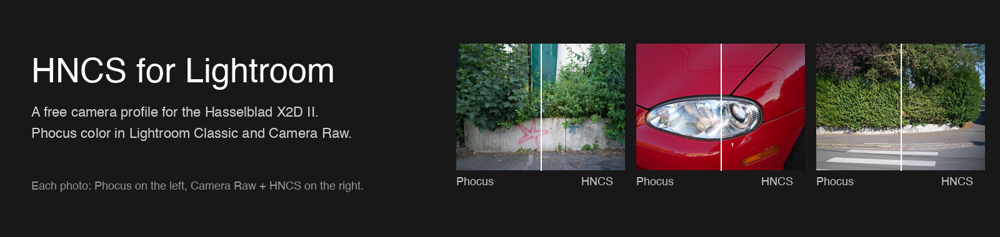
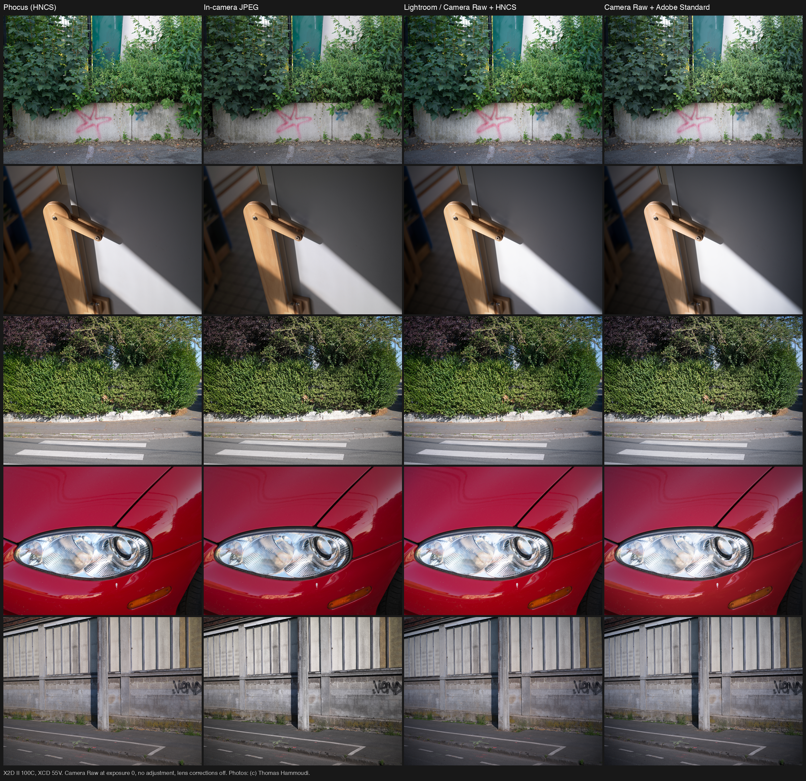
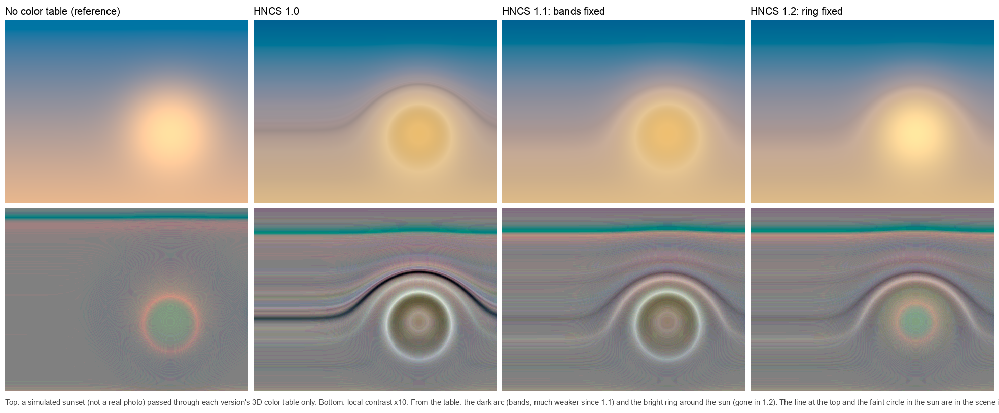

**English** | [Français](README.fr.md)

# HNCS: Hasselblad X2D II color profile for Lightroom Classic

A free Adobe camera profile (`.dcp`) for Lightroom Classic and Camera Raw that reproduces the Hasselblad HNCS color of the X2D II 100C, so a 3FR looks like Phocus's rendering without opening Phocus. It is a camera profile, not a plug-in or a preset, and it works on Mac and Windows.

*Five photos kept out of the fitting. Camera Raw at exposure 0, no adjustment of any kind, lens corrections off; the brightness of each photo is the one the camera writes in the 3FR. Phocus and the camera JPEG are shown as references.*

## Download

### ➜ [**HNCS-Hasselblad-X2D-II.dcp** (latest release)](https://github.com/ThomasHMD/hncs-lightroom-profile/releases/latest/download/HNCS-Hasselblad-X2D-II.dcp)

28 KB, for the X2D II 100C. All versions are in the [Releases](https://github.com/ThomasHMD/hncs-lightroom-profile/releases). The source of the profile and of the tools that made it is this repository, under the MIT license (see [License](#license)).

## What's new

### 1.2: no more ring around the sun

In backlit sunsets, version 1.1 could draw a darker orange ring around the sun. The cause was the top of the 3D color table: for very bright yellow-orange tones, it halved the brightness, so the sky got darker as it got closer to the sun, then jumped to white. In 1.2, brightness always rises with the light, everywhere in the table. Nothing else changed: accuracy against Phocus is identical, and the bands fix of 1.1 is kept. The self-test now also refuses a profile whose brightness goes down anywhere.

### 1.1: fix for banding in skies

Version 1.0 could show faint pink and green bands in smooth, pale gradients, typically a sunset sky that fades from blue to yellow near the horizon (thanks to the X2D user who reported it with a test file). The cause was the profile's 3D color table: for nearly gray colors, its correction changed abruptly from one hue to the next. A pale sky going from blue to yellow passes through gray, so it sweeps through every hue within a few pixels, and each hue got a slightly different correction.

Version 1.1 smooths that part of the table and halves the correction of nearly gray colors. Everything else (tone curve, matrices, saturated colors) is unchanged. On the reported photo, the bands are gone and the sky is about as smooth as with Adobe Standard. Accuracy against Phocus did not get worse: on 16 of the 41 test photos, re-rendered in Camera Raw, the median ΔE2000 is 1.03 for 1.1 and 1.05 for 1.0 with exposure tuned per photo, and 1.21 and 1.30 as is. A permanent check now runs synthetic gradients through gray in `tools/adoucir_look.py --self-test`.

If you installed an earlier version, replace the file with the new one (same name, same place) and restart Lightroom. The profile keeps its name, **HNCS**, so photos already set to it switch to the new version by themselves.

## Install

The profile goes in the **user** folder of Camera Raw. Not in the application folder, not in the system folder.

1. Quit Lightroom Classic.
2. Copy `HNCS-Hasselblad-X2D-II.dcp` into:
   - **macOS**: `~/Library/Application Support/Adobe/CameraRaw/CameraProfiles/`
     (in the Finder: Go ▸ Go to Folder…, then paste the path; the `Library` folder is hidden)
   - **Windows**: `%APPDATA%\Adobe\CameraRaw\CameraProfiles\`
     (paste it in the Explorer address bar; it is `C:\Users\<your-name>\AppData\Roaming\Adobe\CameraRaw\CameraProfiles\`)
3. Start Lightroom Classic again.

Why this folder: the system folders (`/Library/Application Support/Adobe/CameraRaw/CameraProfiles/` on macOS, `C:\ProgramData\Adobe\CameraRaw\CameraProfiles\` on Windows) hold Adobe's own profiles and are managed by Adobe's installer and updates, which can rewrite them. The user folder belongs to you: Lightroom reads it, and an update does not touch it. After a major Lightroom or Camera Raw update, check that the profile is still listed. If it is not, the file is still in the folder: restart Lightroom first, and some users report that resetting its preferences brings third-party profiles back.

Copying the file by hand, as above, is the method I tested.

## Use it

1. Open a 3FR from the X2D II in the Develop module.
2. Basic panel ▸ **Profile** ▸ Browse (the four-square icon). The profile is called **HNCS** and sits in the **Profiles** group, below Camera Matching (not under Adobe Raw). The **Amount** slider at the top of the browser lets you dial it down. Click the star to make it a favorite, so it shows in the Profile drop-down.
3. The profile only appears for X2D II files. It is keyed to Adobe's camera name `Hasselblad 100-22-Coated6`. Another 100-megapixel Hasselblad body may share that name, but I have only tested the X2D II 100C.

### Make it the default for the X2D II

1. On one X2D II photo, choose HNCS as above.
2. In the Presets panel, right-click or use the **+** menu ▸ **Create Preset…**. Name it `HNCS`, click **Check None**, tick only **Treatment & Profile**, create.
3. Lightroom Classic ▸ Preferences (Edit ▸ Preferences on Windows) ▸ **Presets** tab ▸ **Raw Defaults**. Tick **Override global setting for specific cameras**, pick **Hasselblad X2D II 100C** in the **Camera:** list, then in **Default:** choose **Preset** and your `HNCS` preset.

The Camera list is built from the raw photos already in your catalog, so import at least one X2D II photo first. Do not pick **Camera Settings** for this: it only honors styles applied in the camera and does not know about this profile. The default applies to photos imported afterwards; for photos already in the catalog, apply the preset to them. Menu names are those of the Lightroom Classic app itself; Adobe's documentation is [Set up default settings for raw images](https://helpx.adobe.com/lightroom-classic/desktop/help/raw-defaults.html).

## Brightness

HNCS also sets the brightness of each photo automatically. The camera writes that decision in the 3FR (the `BaselineExposure` tag: 0, +1 or +2 EV depending on the shot), and Lightroom and Camera Raw already apply it by themselves. So brightness follows Phocus's, roughly. On the 41 images I kept aside for testing, the remaining difference to Phocus is small, typically within ±0.2 EV (median −0.03 EV, the extremes are −0.57 and +0.20 EV). Photos with a +1 or +2 EV tag come out about 0.2 EV lighter than Phocus. A small touch on the Exposure slider is therefore possible, and it is sometimes needed.

## Accuracy

Differences are measured against a Phocus export (default settings, SDR) of the same 3FR, in ΔE2000 (about 1: hardly visible; 2 to 3: visible side by side). For scale, Phocus and the camera's own JPEG differ from each other by about 2 (median). The measurements use real Camera Raw renders (see [How it was made](#how-it-was-made)), on **41 photos kept out of the fitting**, from 3 lenses (XCD 35-100E, 38V, 55V), at the center of the frame, on uniform patches.

| Median ΔE2000 / 90th percentile | HNCS | Adobe Standard |
|---|---|---|
| All 41 photos, Camera Raw as is (exposure 0) | **1.56** / 4.45 | 2.51 / 5.58 |
| All 41, with exposure tuned for each photo | **1.23** / 3.24 | 1.87 / 4.18 |
| Warm light under 4500 K (10 photos), as is | **1.56** / 4.75 | 3.22 / 5.83 |
| ISO 3200 and above (4 photos), as is | **3.67** / 5.47 | 4.48 / 6.29 |
| Bright areas (24 photos), as is | **2.35** / 6.37 | 2.88 / 6.80 |

The table above and the figures were made with version 1.0; 1.1 and 1.2 only differ in pale, nearly gray colors and in very bright warm tones (see [What's new](#whats-new)).

Limits, as they are:

- **High ISO** (3200 and above) and **bright highlights** are the weak spots: the gap to Phocus stays large there. Only 4 photos at ISO 3200 and above were kept aside, so that number is not solid.
- Phocus renders neutral grays slightly warm. A camera profile cannot carry that without disturbing white balance, so HNCS keeps neutrals neutral. If you like the Phocus warmth, warm the white balance a little.
- Phocus also corrects distortion and vignetting of the lens. This profile does not; the measurements were made with Camera Raw's lens corrections off.
- The Phocus **HDR** rendering is not covered.
- Warm sunset skies come out a little less saturated and lighter near the sun than in the camera's own JPEG/HEIC: the camera compresses its highlights differently for each scene, which a fixed profile cannot do. Lower Highlights and add a little Vibrance if you want them closer.
- Smooth gradients of vivid orange may still show slight banding in places: the color table is still uneven at medium saturation. Not seen yet on a real photo.
- Three lenses were tested. Others (XCD 90V, 25V, 20…) are untested, and Phocus lifts brightness differently depending on the lens.
- The measurements were made on one body and by sampling uniform patches. Skin tones and fine texture were not measured separately.
- They were made with Camera Raw driven from Photoshop, which is the engine Lightroom uses, not with Lightroom Classic itself.

The tools write these reports themselves, so they can be regenerated with your own files (see [`tools/README.md`](tools/README.md)).

## How it was made

I exported pairs of files: the 3FR, and the same photo from Phocus at its default HNCS settings. From about 170 photos (three lenses, ISO 50 to 25600, daylight and warm light), I fitted the profile inside Adobe's own rendering chain (DNG specification 1.7): a tone curve, a small correction of the color matrix, and a 3D color table (hue, saturation, value), with neutrals left untouched. Then I corrected it in two rounds from **real Camera Raw renders**, because my model of the chain differed from Camera Raw by about 1.6 ΔE, mostly in highlights. One photo in four, chosen by lens, was never used for fitting; the table above is on those. (12 of these 41 were also used to choose between the correction rounds, a small bias; the difference between the two last rounds was negligible.)

The tools are in [`tools/`](tools/) (Python, comments in French), with a [README](tools/README.md) that says what each script does and what it needs. The measurements the profile was fitted on are published in [`data/`](data/README.md) (CC BY 4.0), so the fitting scripts run from this repository.

I built it with the help of Claude Code (Anthropic's coding assistant), which wrote much of the Python in `tools/` under my direction. The method, the choices and the measurements are mine, and I checked the results in real Camera Raw renders.

## Credits and prior art

- [Konrad Michels, "What a Lightroom Camera Profile Can and Cannot Reproduce from Phocus"](https://blog.tonalphoto.com/lightroom-camera-profile-phocus-color/) (Tech Behind the Frame): same approach, fitting a Lightroom camera profile to Phocus renders of the X2D II. His profile is not distributed, which is why I made this one public.
- [dcamprof](https://github.com/Entropy512/dcamprof) (GitHub mirror) by Anders Torger, used to cross-check my rendering model and as a first approach. It is GPL-3.0 and is not included: my scripts only call it as an external program. I kept my own fitting, which measured better in Camera Raw.
- The profile structure follows Adobe's DNG specification. The colour matrices come from Adobe's own profile (see [License](#license)).

## License

- **The tools and the documentation**: MIT ([`LICENSE`](LICENSE)).
- **The profile** (the tone curve, the 3D color table and the correction I applied to Adobe's forward matrices): also MIT. The two color matrices (`ColorMatrix1`, `ColorMatrix2`) and the calibration illuminants stored in the file are copied unchanged from the `Adobe Standard` profile of the same camera, which Adobe distributes with Lightroom (the profile carries the tag "Allow Copying"). I claim no rights on them. Details: [`THIRD_PARTY_LICENSES.md`](THIRD_PARTY_LICENSES.md).
- **The data** (`data/`, the block measurements): CC BY 4.0, © Thomas Hammoudi. Credit me and link this repository. Details in [`data/README.md`](data/README.md).
- **The photos** (the two figures in `docs/figures/`): © Thomas Hammoudi, all rights reserved. They are not under the licenses above, which cover the code, the profile, the data and the analyses.

## Disclaimer

Independent project, **not affiliated with or endorsed by** Hasselblad or Adobe. "Hasselblad", "X2D", "Phocus" and "HNCS" (Hasselblad Natural Colour Solution) are trademarks of their owners, as are "Adobe", "Lightroom" and "Camera Raw". This repository contains no Hasselblad software and no Phocus image file: only a camera profile that approximates a rendering, and block averages (16 x 16 px, uniform patches) measured on Phocus exports of my own photos. Use at your own risk.
