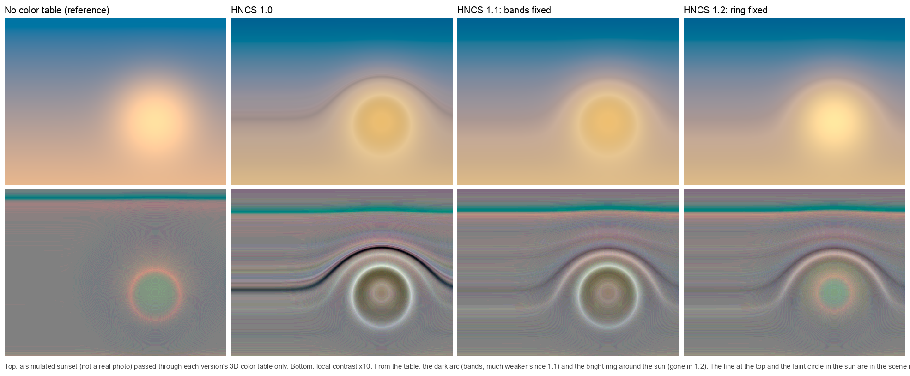

**HNCS 1.2** removes a darker ring that could appear around the sun in backlit sunsets. It keeps the banding fix of 1.1.

## What changed

- **1.2**: at the very top of the 3D color table, very bright yellow-orange tones had their brightness halved, so the sky got darker near the sun before jumping to white. Brightness now always rises with the light. Accuracy against Phocus is unchanged.
- **1.1** (kept): no more pink and green bands in pale skies that fade from blue to yellow.
- The self-test of `tools/adoucir_look.py` now refuses a profile that breaks gradients through gray or whose brightness goes down anywhere.

Thanks to the X2D user who sent sunset test files.

## Update

1. Download `HNCS-Hasselblad-X2D-II.dcp` below.
2. Quit Lightroom Classic and replace the old file in the **user** Camera Raw folder: `~/Library/Application Support/Adobe/CameraRaw/CameraProfiles/` (macOS) or `%APPDATA%\Adobe\CameraRaw\CameraProfiles\` (Windows).
3. Restart Lightroom. The profile is still called **HNCS**: photos already set to it switch to 1.2 by themselves.

SHA-256: `04415637dc38e732518e17fe46f0d6fb9d93b69773c51d619a45094988d9f3d5`

## Known limitations

- Warm sunset skies are a little less saturated and lighter near the sun than in Phocus or the camera's HEIC: Camera Raw's own highlight processing loses some of these yellows with every profile, by a different amount in each photo. Lower Highlights, add a little Vibrance.
- Weaker at ISO 3200 and above and in bright highlights; three lenses tested; Phocus lens corrections and HDR not covered.

## License

MIT for the tools and the profile, except the two color matrices copied from Adobe's own profile, the data in `data/` (CC BY 4.0) and the photos in `docs/figures/`. See [`LICENSE`](https://github.com/ThomasHMD/hncs-lightroom-profile/blob/main/LICENSE) and [`THIRD_PARTY_LICENSES.md`](https://github.com/ThomasHMD/hncs-lightroom-profile/blob/main/THIRD_PARTY_LICENSES.md).
